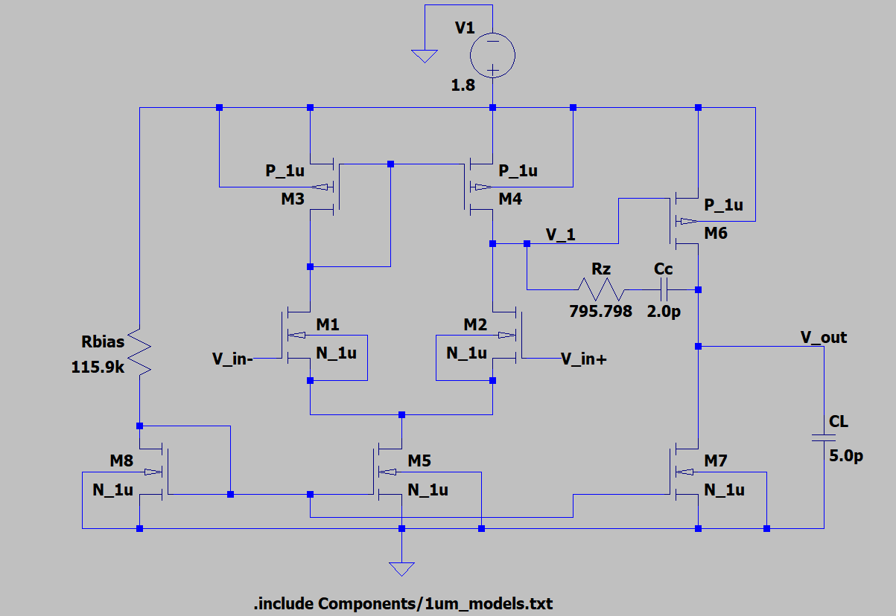

# Design and Analysis of a Two-Stage CMOS OTA Using LTspice
## Introduction
An Operational Transconductance Amplifier (OTA) converts a differential input voltage into an output current. It is an important building block in analog circuits and is used in applications such as filters, data converters, and other analog signal-processing circuits.

This project involves the design, simulation and analysis of a two-stage CMOS OTA using LTspice. The main objective is to achieve high voltage gain, sufficient bandwidth, stable operation, and low power consumption while driving a capacitive load

The circuit is simulated under different conditions to evaluate its AC response, transient response, input common-mode range, common-mode rejection ratio (CMRR), and power-supply rejection ratio (PSRR).

### Design Parameters
- Supply Voltage: 1.8 V
- Load Capacitance: 5 pF
- Simulation Tool: LTspice

## Architecture

The OTA consists of two amplification stages and a frequency compensation network.

### Stage 1: Differential Amplifier

This stage has a NMOS differential input pair with a PMOS active current mirror load. The differential pair amplifies the difference between two input voltages while the active current mirror load converts the differential input to single ended output. A NMOS tail current source is used to set the bias current of the differential pair.

### Stage 2: Common Source Amplifier

The second stage uses a PMOS common-source amplifier with an NMOS current sink. This stage provides additional voltage gain and drives the output load.

### Frequency Compensation Network

A two-stage amplifier can become unstable due to the presence of multiple poles in its frequency response. To improve stability, Miller compensation is used.

The compensation network consists of a capacitor ($C_c$) and a series resistor ($R_z$). The capacitor helps separate the dominant pole from the other poles, while the resistor is used to control the zero introduced by the compensation network.

## Design Specifications and Simulation Results

The following table compares the target specifications with the results obtained from LTspice simulations. 

| Parameter | Target | Simulated Result |
|---|---:|---:|
| Supply Voltage | 1.8 V | 1.8 V | 
| Open-Loop DC Gain | ≥ 60 dB | 68.525 dB |  
| Gain-Bandwidth Product (GBW) | ≥ 10 MHz | ≈9.719 MHz |
| Phase Margin | ≥ 60° | ≈78.4° |
| Slew Rate | ≥ 5 V/µs | 4.959 V/µs |
| Settling Time (0.1%) | ≤ 500 ns | 100.53 ns |
| Input Common-Mode Range (ICMR) | 0.8–1.6 V | 0.41–1.658 V |
| Quiescent Supply Current | ≤ 275 µA | 126.589 µA |
| Power Consumption | ≤ 500 µW | 227.86 µW |
| Load Capacitance | 5 pF | 5 pF |

*Table 1: Design Specifications and Simulation Results*

The simulated open loop DC gain, ICMR and phase margin meet the specified targets. The GBW and slew rate are slightly below their respective targets, while the settling time and power consumption are within the specified limits.

## Additional Simulation Results

The following table summarizes the additional performance characteristics evaluated through LTspice simulations

| Parameter | Simulated Result |
|---|---:|
| Common-Mode Rejection Ratio (CMRR) | 77.38 dB |
| Power Supply Rejection Ratio (PSRR) | 73.07 dB |
| Output Voltage Swing | 0.41–1.645 V |

*Table 2: Additional Simulation Results*

## Circuit Schematic



For detailed simulation results and analysis, refer to the [Design Report](Report/LTspice_OTA_Design_Report.pdf).

## Transistor Sizing

All transistors use a channel length of $1.0\,\mu\text{m}$. The transistor widths used in the design are given below.

| Transistor | Function | Type | Width ($W$) ($\mu\text{m}$) | Length ($L$) ($\mu\text{m}$) |
|---|---|---|---:|---:|
| M1, M2 | Differential input pair | NMOS | 2.63 | 1.0 |
| M3, M4 | Active current-mirror load | PMOS | 14.81 | 1.0 |
| M5 | Tail current source | NMOS | 2.30 | 1.0 |
| M6 | Second-stage common-source amplifier | PMOS | 139.60 | 1.0 |
| M7 | Second-stage current sink | NMOS | 10.84 | 1.0 |
| M8 | Bias transistor | NMOS | 1.15 | 1.0 |

**Note:** Transistor sizing is based on assumed design parameters ($\mu_n C_{ox}$, $\mu_p C_{ox}$, $V_{TH,n}$, $V_{TH,p}$) for a 180nm CMOS process framework. For full parameter tables and analytical calculations for transistor sizing, refer to the [Design Report](Report/LTspice_OTA_Design_Report.pdf).


## Passive Component Sizing

| Component | Value | Function |
|---|---:|---|
| $R_{\text{bias}}$ | 115.9 kΩ | Bias generation |
| $R_z$ | 795.8 Ω | Nulling Resistor |
| $C_c$ | 2.0 pF | Miller compensation |

## Simulation Methodology

Separate LTspice testbenches are used to evaluate the OTA's performance.

- AC Analysis: `testbench_ac.asc` — evaluates open-loop gain, gain-bandwidth product, and phase margin.
- Transient Analysis: `testbench_transient.asc` — evaluates slew rate and settling time.
- CMRR Analysis: `testbench_cmrr.asc` — evaluates common-mode rejection ratio.
- PSRR Analysis: `testbench_psrr.asc` — evaluates power-supply rejection ratio.
- ICMR and Output Voltage Swing Analysis: `testbench_icmr_and_output_swing.asc` — determines the input common-mode range and output voltage swing.
- DC Operating Point: `testbench_operating_point.asc` – DC bias voltages and branch currents

The simulations are used to characterize the OTA's performance under different operating conditions.

## Repository Structure

```text
.
├── README.md
├── Images/
│   ├── AC_Response.png
│   ├── A_cm_dm_CMRR.png
│   ├── Block_Diagram.png
│   ├── circuit_diagram.png
│   ├── icmr_and_output_swing.png
│   ├── psrr.png
│   ├── testbench_ac.png
│   ├── testbench_cmrr.png
│   ├── testbench_icmr.png
│   ├── testbench_operating_point.png
│   ├── testbench_psrr.png
│   ├── testbench_transient.png
│   ├── tradeoff_ac.png
│   ├── tradeoff_transient.png
│   └── Transient_Response.png
├── Report/
│   └── LTspice_OTA_Design_Report.pdf
├── Resources/
│   └── Two_Stage_Opamp.pdf
└── Schematics/
    ├── circuit_diagram.asc
    ├── testbench_ac.asc
    ├── testbench_cmrr.asc
    ├── testbench_icmr_and_output_swing.asc
    ├── testbench_operating_point.asc
    ├── testbench_psrr.asc
    ├── testbench_tradeoff_ac.asc
    ├── testbench_transient.asc
    ├── testbench__tradeoff_transient.asc
    └── Components/
        └── 1um_models.txt
```

## Setup and Usage

1. Install [LTspice](https://www.analog.com/en/resources/design-tools-and-calculators/LTspice-simulator.html).
2. Clone or download this repository.
3. Open `Schematics/circuit_diagram.asc` to explore and modify the base OTA circuit. The schematic does not include a predefined input signal, allowing users to configure the input sources and operating conditions according to their requirements.
4. To reproduce the provided analyses, open the required testbench from the `Schematics/` directory.
5. Click **Run** in LTspice to execute the simulation.
6. Use the waveform viewer to inspect the relevant voltages and currents.
7. Ensure that the model file (`Schematics/Components/1um_models.txt`) is downloaded to run any of the simulation files.

The testbenches are intended for specific performance analyses. Refer to the [Design Report](Report/LTspice_OTA_Design_Report.pdf) for the simulation methodology, results, plots, and detailed analysis.

## References

The following video tutorial playlists by Hafeez KT were consulted to understand the underlying analog circuit design principles and analytical methods used in this project:

* Differential Amplifier Design ([Playlist](https://www.youtube.com/playlist?list=PLK2eyR1C9gjrMCVXRvKhY7CjNZYGCgMnY)): Differential Pair Analysis and Transistor Sizing
* Two-Stage Op-Amp Design ([Playlist](https://www.youtube.com/playlist?list=PLK2eyR1C9gjoBp61ZDvz6Zdd_6Hu7vZTz)): Miller Compensation, Stage 2 Design, Small Signal Modelling
* Two-Stage CMOS Op-Amp — Chapter 5: [Local PDF](Resources/Two_Stage_Opamp.pdf) | [Online source on Scribd](https://www.scribd.com/document/251490821/Chapter-5-Two-Stage-Cmos-Op-Amp) — theoretical background and compensation-capacitor selection.